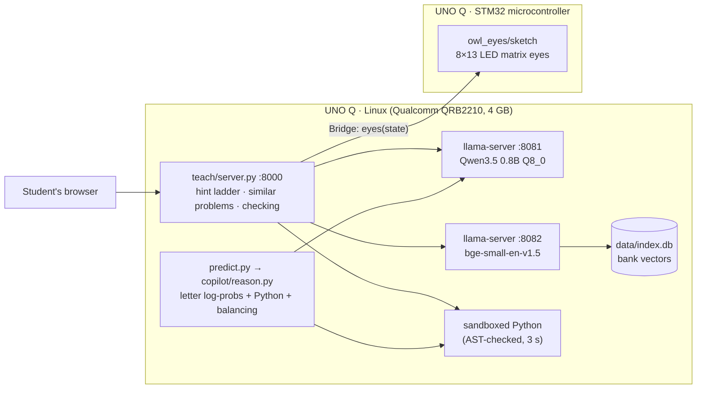

# Owl Tutor: an offline math copilot on the Arduino UNO Q

**Datathon FME 2026 · Qualcomm challenge "Math on the Edge" · team TIC's Friends**

Owl Tutor is a math copilot for Kangaroo-style competition problems that runs entirely on an Arduino UNO Q 4 GB, with no network. It sits inside a 3D-printed owl. It has two modes:
- **Reason** solves a multiple-choice problem within 60 seconds. A small language model writes a short Python program, the board runs it, and the result is matched to an option.
- **Teach** never gives the answer. The student gets a 3-step hint ladder in English or Catalan, checks their answer, and practises a similar problem. The owl's LED-matrix eyes show what it's doing: thinking, hinting, happy, worried.

> 📷 *Photo / 20-second video of the owl on the board: TODO*

## Architecture



- **Linux side.** Two `llama-server` processes run as systemd services: Qwen3.5 0.8B (Q8_0, 835 MB) and bge-small-en-v1.5 (37 MB). `predict.py` and the Teach server call them over HTTP on `127.0.0.1`.
- **Microcontroller side.** `owl_eyes/sketch/sketch.ino` stores 78 frames for 8 animated states. The Linux side asks for a state over the Arduino Bridge (`Bridge.call("eyes", "thinking")`).
- **How we use M3Kang.** The bank of 1,466 English training problems is embedded with bge into `data/index.db` (built on the board, never committed), so Teach can offer similar problems. M3Kang is for research use only: no problem text or image is in this repository. Dataset card: <https://huggingface.co/datasets/qualcomm/M3Kang> (Torres-Camps et al., 2026, [arXiv:2601.16218](https://arxiv.org/abs/2601.16218)).

### Reason: how one problem is answered (copilot/reason.py)

1. **Letter probabilities.** The model reads the problem and options once; we keep its probability for each letter A–E. This is the fallback answer (~10 s on the board).
2. **Python.** The model writes a short program ("compute the answer and print only the final value"). We parse it, reject anything that isn't plain computation (imports limited to `math`, `itertools`, `fractions`, `functools`, `collections`; no files, no `exec`, no dunders), and run it in a separate Python with a 3 s limit. If the printed number equals exactly one option, that option is the answer. The model writes until 50 s have passed (`ANSWER_BY_SECONDS`), then we answer with what we have.
3. **Balancing.** The practice answer key uses each letter exactly 10 times, and the model over-uses A and D. After all problems, the letters from step 1 are re-assigned so each letter is used about n/5 times, choosing the most probable assignment (an exact assignment in pure Python). Answers from step 2 never change. Turn it off with `--no-balance` or `BALANCE_LETTERS=0`.

### Teach: where a hint comes from (copilot/teach.py)

The 0.8B model is poor at inventing hints. It told students a kangaroo "lands on 11" when the answer is 10. It is much better at explaining a program that works. So:
1. When a problem opens, the board starts solving it with Reason's Python route (the owl closes its eyes).
2. **Hint 1** is always a strategy question chosen from the wording: smaller cases, repeating patterns, systematic counting, drawing, equations, extremes, or testing the options. These are written by hand in English and Catalan, so they are always correct.
3. **Hints 2 and 3** (the method, the first step) explain the board's own program in words, when its result matches an option and the answer key agrees. Otherwise they fall back to the strategy's method and first step.
4. A guard drops any sentence that says "the answer is", states an option's value as a result, or names the correct letter.

## How to replicate it

Start from a board set up with steps 0–12 of the [datathon README](docs/SETUP_GUIDE.md): llama.cpp built, both models as services.

```bash
# On the board
git clone https://github.com/u215231/datathon-UPC-maths-qualcomm-arduino-unoq.git ~/owl
cd ~/owl
python3 laptop/prepare_m3kang.py --out data          # problems + OCR'd options (needs the M3Kang parquet)
python3 build_index.py                               # bank vectors for similar problems (~10 min)

# Reason: the official entry point
python3 predict.py --input data/val.jsonl --output results/predictions.csv
# Each line: [n/N] id -> letter in seconds (status, letter|code); then "Balanced the letters: k of N changed"

# Teach: open http://<board-ip>:8000, or `adb forward tcp:8000 tcp:8000` and http://127.0.0.1:8000
python3 teach/server.py --host 0.0.0.0
```

The owl's eyes: create an App Lab app with `owl_eyes/sketch/` as its sketch and start `teach/server.py` from its Python side (see `owl_eyes/README.md`). Without App Lab, the page works and the eyes stay off.

## Results

All Reason numbers are on the organisers' **practice set: 50 new problems × English/Catalan = 100 rows**. They are not M3Kang problems, and the answer key has 10 of each letter, so chance is 20%. With 100 rows, one problem is 1 point and differences under ~6 points are noise.

| Pipeline (Qwen3.5 0.8B unless noted) | Accuracy | Board time per problem |
| --- | --- | --- |
| One letter (organisers' baseline pipeline) | 22% | ~3–10 s |
| Think freely, cut at 50 s, force a letter | 25% | 50 s |
| Qwen3.5 2B, one letter / thinking | 21% / 19% | too slow to think |
| Qwen3.5 4B, one letter | 22% | 91 of 100 over 60 s |
| Python only (program's number matched to an option, else forced letter) | 32% | mean 27 s, max 50 s |
| **Letter + Python + balancing (shipped)** | **35% (laptop) / {BOARD}% (board)** | **mean {MEAN} s, max {MAX} s** |

- When the program's number matched an option, it was right **11 times out of 14** (laptop).
- Balancing alone, over 1,000 simulated 20-problem tests drawn from the practice set: +1.0 problem on average for the letter-only pipeline; better in 59% of tests, worse in 24%.
- Measured board speeds (llama-bench): 0.8B Q8_0 reads 11.1 / writes 5.7 tokens/s; 2B Q4_K_M 4.2 / 2.2; 4B Q4_K_M 1.7 / 1.1.

Earlier, on 281 held-out M3Kang English problems (official id split): one letter 23.5%, two retrieved examples 24.2%, short reasoning 24.9%, Python-or-level-prior 25.6%. No-model baselines: always D 23.1%, most common letter per level 24.6%.

## Error analysis

{BY LEVEL / LANGUAGE TABLE FROM THE BOARD RUN}

## What didn't work

- **Bigger models.** Qwen 4B with reasoning reached 35% on M3Kang but reads a practice problem in ~68 s on the board. 2B is no better than 0.8B within 60 s.
- **Free thinking.** The 0.8B never finishes its thinking within the budget; it restates the problem.
- **Fine-tuning on the bank.** A full fine-tune of the 0.8B on problem → letter (RunPod, ~$0.54) learned the 1,747 bank problems by heart (24/24 on the board) but stayed at chance on unseen problems (22–26%). M3Kang has no worked solutions, so there was nothing to learn but the letters.
- **Free-form hints.** Without grounding, the 0.8B's hints were often wrong or gave the answer away.

**Next:** distil short Python solutions from a large model into the 0.8B, so it learns a method rather than letters; Catalan similar-problem retrieval; more strategy hints.

## Repository map

| Path | What |
| --- | --- |
| `predict.py`, `eval.py` | official entry point, evaluation |
| `copilot/reason.py` | Reason: letter log-probs, sandboxed Python, balancing |
| `copilot/teach.py`, `teach/` | Teach: hint ladder, similar problems, web page |
| `owl_eyes/` | LED-matrix eye animations (sketch, Bridge helper, previews) |
| `machine/` | laptop experiments: model screening, fine-tuning, analysis; `show_outputs.py` shows the model's replies |
| `config.env` | pinned models and llama.cpp commit, Reason settings |

## The team

TIC's Friends: {NAMES}. Built on the organisers' starter repository (mpous/datathon-UPC-maths-qualcomm-arduino-unoq).
